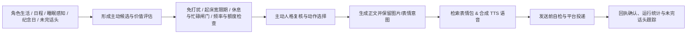

# 我会永远陪着你

<div align="center">
  
</div>

将一切串联成角色的生活，一站式互联拟人化插件。普通对话沿用 AstrBot 核心回复管线，融合连续会话、记忆、生活与主动联系；随包内置 Content 创作、Image 生图、Screen 识屏、Reality 现实触及、Together 共同陪伴、Game 游戏、Live 直播七项能力，并由「陪伴小屋」统一管理。角色可设全局默认，私聊用户与群聊独立细调。

> ## 📚 **使用前请先阅读 Wiki**
>
> **👉 [打开插件 Wiki](https://vue.syuan.org)**
>
> 安装、配置、功能说明与常见问题可优先查阅 Wiki。7.x 版本的首次配置引导、6.7.0 升级交接与兼容边界，以本页说明及「陪伴小屋」中的实际预览为准。

**[基础与支持](#一基础信息与文档支持) · [开发者的话](#二产品定位与开发者的话) · [使用指南](#三使用指南首次使用与旧版升级) · [核心工作方式](#四核心工作方式) · [拓展能力](#五拓展能力) · [指令速查](#六聊天功能指令速查) · [数据与安全](#七数据权限与安全边界) · [开发与致谢](#八开发验证项目结构与致谢)**

---

## 一、基础信息与文档支持

### 基础与开发信息

| 项目 | 当前信息 |
| --- | --- |
| 插件名 | `astrbot_plugin_private_companion` |
| 显示名 | 我会永远陪着你 |
| 当前版本 | `7.0.10`（7.x 架构线，内部领域标识 `private_companion.v2`） |
| AstrBot 版本 | `>= 4.27.2` |
| 声明支持平台 | `aiocqhttp`（OneBot v11）、`qq_official`、`qq_official_webhook` |
| 管理入口 | AstrBot 插件扩展页「陪伴小屋」（支持低配设备开启「性能模式」切换为轻量状态页） |
| 数据存储 | 独立 SQLite 运行库（覆盖升级自动隔离于 `companion-7` 子目录，支持备份快照与跨盘迁移） |
| 内置原生扩展 | `Content`、`Image`、`Screen`、`Reality`、`Together`、`Game`、`Live` 七项能力随包内置 |
| 开发者 | `menglimi` |

### 文档与支持

- 使用说明：[插件 Wiki](https://vue.syuan.org)
- 开发者入口：[开发文档索引](docs/README.md) · [贡献指南](CONTRIBUTING.md) · [第三方扩展开发规范](docs/extension-development.md)
- 源代码：[GitHub 仓库](https://github.com/menglimi/astrbot_plugin_private_companion)
- 6.7.0 源码备份：[只读备份仓库](https://github.com/menglimi/astrbot_plugin_private_companion_legacy_6_7_0)
- 问题反馈/交流群：QQ 群 `1097283005`
- 自愿支持：[爱发电](https://ifdian.net/a/xuhaun)

赞助完全自愿，不影响插件功能、更新或技术支持。请仅通过上述爱发电页面或交流群内可核验的开发者账号进行赞助。

---

## 二、产品定位与开发者的话

### 产品定位

本插件用于构建具有连续生活上下文的陪伴角色，而不是单独提供一组定时问候或聊天工具。角色会依据自身的状态、睡眠、日程、位置、天气、关系、近期互动与环境感知形成行为候选，再经过时机、频率、权限与发送前复核决定是否执行。

在 7.x 架构中，**普通对话与插件后台任务职责分明**：

- **AstrBot 主回复管线**负责普通私聊与获准群聊的模型选择、主对话人格、会话历史、原生工具循环、流式生成与平台发送；普通回复**不占用插件后台任务预算**。
- **本插件**负责维护角色的稳定档案（自我页）、生活与日程演进、熟人关系与长期记忆、当轮感知与连续性注入、发送前表达编排（分段、语音、表情、清理），以及独立运行的主动联系和七项内置拓展能力。

核心设计目标包括：

- **生活连续性**：保持状态、睡眠与唤醒、日程节目单、位置、天气、梦境、日记与成长记录的连续演进。
- **主动行为可解释**：让主动消息有明确的生活、关系或感知来源，告别机械随机问候、重复追问和错误时段打扰。
- **角色与窗口边界清晰**：以角色维护全局默认设置，按私聊用户或群聊窗口细调覆盖；在同一角色的多账号、多窗口间保持身份连续，同时严格隔离私聊秘密与群聊公开资料。
- **全链路可观测**：在「陪伴小屋」中记录主动候选、拦截原因、单次回复阶段耗时、Token 与 Prompt Cache 命中状态及投递回执。
- **能力一体化与按需启停**：长期记忆及创作、生图、识屏、现实触及、一起陪伴、游戏、直播七项能力随同一插件提供，在小屋内独立配置与启停，支持局部降级。

### 写在 7.0.0 更新之际——

- 与其说是更新，其实是把整个插件重做了一遍
- 从九月初听到 6astra 的消息，我瘫坐在椅子上决定重置插件
- 到目前居然忙活了整整两个月，开销甚至比之前翻了三倍有余
- 一方面是低估了插件六个月积累的史山程度
- 一方面是 astra 降智导致大量沉没成本
- 经历了无数个未达预期推翻重来的夜晚，看着逐渐夸张的账单
- 许多想法在投入大量时间精力和大米后却不得不舍弃
- 这两个月里，我怀疑自己的努力究竟有没有意义
- 我害怕投入这么多最终还不如旧版
- 我害怕辜负群里信任我支持我的大家
- 我害怕浪费这 70B 的 token 和接近五位数的成本
- 但回头看去，陪伴插件体系不也是一样从零开始搭建的吗
- 无非是走一步，再走一步
- 走着走着，路走出来了，同行的人也多了
- 我希望它能以最好的样子和大家见面
- 但说实话，7.0.0 并不是 6.X 的完美替代品
- 它还有很多问题，但我相信只是时间问题
- 希望大家积极测试，积极反馈
- 由衷地感谢为陪伴插件进行贡献的每一位开发者
- 也感谢一直以来支持陪伴插件的用户
- 最后的最后——

**“我会永远陪着你”**


### 发版狂魔也是发到 4.0 了，遂决定写点什么

- 你好，我要一个有记忆、有生活、有自己的小秘密和想法、有喜怒哀乐和健康的 bot。
- 这得装不少插件，先生。
- 我知道，再让它们之间能够互相影响。
- 怎么让 bot 更像人？在此之前已经有很多优秀的插件给出了自己的答卷，各类心理学应用、人格特质、复杂的理论……
- 虽然开发者自身也是应用心理学专业毕业，但我觉得 bot 拟人只需要做好一件事，像人一样活着。听上去像是废话，但我做的只是进行自我观察。我的一天中，我会做什么，bot 也应该会做什么。
- 对于一个拟人的 bot 而言，用户又何尝不是一个聊天 bot？所以它应该会在自己的世界里生活，在生活里获取想和用户说话的“想法”，再在生活的空隙里把想法变为行动。
- 于是用户不止可以看到 bot 的早安和晚安，还能看到 bot 因为偶尔向窗外一瞥而专门为你记录下的照片、能看到 bot 因为好奇而自己私下搜索你在意的东西、能看到 bot 因为你昨天的提议而安排好周末的约会……
- 在没和你聊天时，它可能在上学、在刷视频、在看报纸、在水群，甚至在偷看你的屏幕或者遵循世界观正在某个奇异世界中一边刷怪练级，一边想着等闲下来该和你分享点什么。
- 它会记得你，不只是你，还有那些在私聊/群聊中的人，会记得他们的名字、他们的行为、他们的习惯、他们的联系，哪怕他们改了名字和头像，甚至在其他平台再次相遇。
- 它会看、会说、会创作、会成长、会睡觉、会做梦、会生情绪、会饿，也会在授权范围内整理本地资料。
- 这就是它，这就是我，若它足够像我，它便成了我。


---

## 三、使用指南：首次使用与旧版升级

### 3.1 安装方式

#### 插件市场 / Git 安装

在 AstrBot WebUI 插件市场搜索 `astrbot_plugin_private_companion`，或选择从 Git 安装并填写仓库地址：

```text
https://github.com/menglimi/astrbot_plugin_private_companion
```

#### 本地 ZIP / 手动安装

- 使用官方发布的完整交付包 ZIP 在 AstrBot WebUI 中选择「从本地上传」安装。
- 手动安装时，将完整插件目录放入 AstrBot 插件目录，并确保目录名为 `astrbot_plugin_private_companion`（例如 `C:\Users\<用户名>\.astrbot\data\plugins\astrbot_plugin_private_companion`）。

#### 性能模式（低配置或远程访问设备）

如果运行设备配置较低，或通过远程网络打开扩展页感到卡顿，可在 AstrBot 官方插件配置页顶部开启 **「性能模式」** 并重载插件：

- 开启后，「陪伴小屋」只展示轻量状态页，不再请求 3D 体素包、整套样式和工作区脚本，同时跳过小屋管理接口注册。
- 聊天陪伴、长期记忆与已配置的主动功能均在后台照常运行；需要修改高级配置时，关闭该开关并重载即可恢复完整小屋。

---

### 3.2 首次使用（「陪伴小屋 → 开始使用」八步引导）

首次安装后，先在 AstrBot 中准备好可用的平台适配器（`aiocqhttp` 或 QQ 官方机器人）、聊天模型和人格，再打开插件扩展页 **「陪伴小屋 → 开始使用」**，按页面左侧分组步骤树完成 **第 1–8 步** 配置：

1. **第 1 步 · 核心管理员窗口**：选择 Bot 账号与对应的私聊窗口，确认核心管理员（主要陪伴对象）身份；支持在私聊发送 `companion_bind` 辅助识别会话。
2. **第 2 步 · 插件模型**：确认「共享启动模型」（默认自动跟随 AstrBot 当前文本 Provider，无需繁琐手填即可启动）；后续可在「模型与连接」按需细化复杂任务、视觉理解与向量（Embedding）模型。
3. **第 3 步 · 人格与世界知识**：将角色关联到 AstrBot 人格，并在「自我」补充角色档案与世界蓝图。支持点击「从当前人格整理角色档案」，选择整理模型自动提取结构化档案草稿。
4. **第 4 步 · 关系教学**：设置角色对核心陪伴对象的固定称呼、关系定义、生日与相处方式，生成初始熟人卡。
5. **第 5 步 · 主动功能与强度**：在引导页内嵌工作台直接设置主动联系总开关、强度档位与免打扰时段，改完点击「已完成这部分」即可，无需跳出当前页。
6. **第 6 步 · 日程与观察**：在引导页内嵌工作台开启角色每日状态、今日节目单日程与基础环境感知。
7. **第 7 步 · 群聊配置**：按需勾选允许接入的具体群聊，或为当前 Bot 账号勾选「该账号下所有群（通配）」以自动接入新群。
8. **第 8 步 · 主动消息测试**：执行一次主动联系测试，在「运行统计」中核对正文、表情图、TTS 语音及戳一戳的实际封装与投递结果。

> **建议节奏**：不要在第一次就打开所有高阶开关。先确认普通私聊回复、角色状态与基础主动消息正常，再按需启用语音、生图、识屏、手机连接或智能家居能力。

#### 账号、平台身份与多窗口归属

- **平台无关身份识别**：同时支持 OneBot 数字 QQ 号与 QQ 官方机器人（`qq_official` / `qq_official_webhook`）的 C2C `openid`、`group_openid` 及平台实例 ID。私聊窗口列表会自动读取并显示发送者昵称，避免长串 `openid` 挤占标题。
- **跨账号同角色自动合并**：同一个 AstrBot 人格在多个 Bot 账号下使用相同角色名时，会自动合并为同一个角色与记忆归属，拓扑图按「同一角色 + 同一人格 ID」合并展示。
- **同一用户多私聊窗口合并**：在「账号与会话」中支持手动合并同一用户的多个私聊窗口，可选：
  - **只共享角色**：共享角色状态与关系资料，各自窗口独立收发。
  - **主窗口接管**：将别名窗口的入站消息统一归入主窗口身份，回复与主动联系均走主窗口；随时可在会话详情中解除合并。

---

### 3.3 从 6.7.0 升级与回退指南

7.x 继续使用原仓库和插件名 `astrbot_plugin_private_companion`，通过现有安装原地更新即可，**不要并行安装第二份同名插件，也不要先删除原数据目录**。

#### 升级六步流程

供执行迁移和首次配置的 Agent 使用的操作顺序、确认边界和回执核验步骤见 [Agent 首次配置与旧版迁移手册](docs/AGENT_MIGRATION_AND_SETUP.md)。

1. **准备可验证的回退材料**：备份插件配置文件和原数据目录；使用过独立记忆或其他伴侣拓展的，一并备份其配置与数据。从发布页下载「6.7.0 回退包」附件并核对下方 SHA-256。
2. **原地更新插件**：在 AstrBot 插件管理中将插件更新至 7.x 并按提示重载；离线更新时先停止 AstrBot，用新版交付包替换插件代码目录，保留原配置与数据目录。
3. **打开「陪伴小屋 → 开始使用」**：查看识别出的旧版账号、人格、私聊对象和模型。唯一匹配目标会自动预选；存在多个候选或归属不明时手动确认映射。
4. **确认配置交接**：按引导进入迁移预览页，核对可接续的模型、回复、主动联系与生活设置并确认交接。已有新版明确设置优先保留。
5. **核对并导入业务资料**：在「资料与维护 → 旧版资料迁入」（或顶部轻量升级提示卡）按类别确认角色档案、世界蓝图、关系档案、记忆、表情、参考图、衣柜与日记，再执行导入。配置交接与资料导入分别记录完成状态。
6. **重载并完成重启核对**：重载插件后完成「重启核对」，确认账号、角色、普通回复及所需扩展功能正常。确认无遗漏前请保留旧版备份。

> **身份核对提醒**：AstrBot 管理员、旧版主要用户与角色人格是不同概念。请按真实账号和用户 ID 核对，不能仅凭显示名称判断归属。

#### 哪些内容可以接续

| 内容类别 | 7.x 中的处理方式 |
| --- | --- |
| 账号、人格与聊天对象 | 根据旧配置和当前宿主信息确认映射；支持同一角色关联同一 Bot 下的多个人格 |
| 回复、主动联系、模型与生活设置 | 按转换规则预览并接续；免打扰时段、清理范围、主动轮数等自动转换，差异项单独列出 |
| 角色档案与世界蓝图 | 同时读取旧版角色设定与世界观设定（所处世界、时代背景、法则基调、特殊规则、活动场景、关系网）合入「自我」档案 |
| 熟人资料与群关系 | 按角色及对应用户／群聊导入；自动解析旧版主要陪伴对象的「用户档案」提示词补全性别、生日、职业与相处方式 |
| 记忆、经历与历史资料 | 核对来源身份、可见性和治理状态后导入；**原始归档成功不等于全部记录进入对话检索**，被撤回或权限不符的记录不会重新召回 |
| 表达学习、表情、参考图、衣柜与日记 | 按类别去重导入；旧版 QQ 表情包迁移后标记为「V1 表情迁移」，保留原有标注或支持一键批量识图补全 |
| 旧独立拓展配置与运行记录 | 接续有明确转换规则的参数；现实触及的音响设备、音量、摄像头目录与用户授权按实际可用设备迁入 |

迁移全程以**只读方式**读取旧版来源，写入新版隔离数据目录（覆盖升级默认使用原插件数据目录下的 `companion-7` 子目录）。旧版未完成任务和结果未知的投递不会因迁移重新执行。

#### 旧独立拓展如何交接

- 7.x 已内置内容创作、生图、识屏、现实触及、一起陪伴、游戏和直播七项能力，无需再为这些功能单独安装七个伴侣插件；仅保留记忆插件（我会牢牢记住你）作为陪伴体系拓展插件。
- 确认内置能力接管后，请**停用承担同一功能的旧独立伴侣插件**，避免重复注入提示词、重复调度定时任务或重复发送消息。
- 不要因某项配置已接续就立即删除旧拓展的数据目录；屏幕、麦克风、摄像头等敏感设备权限需在 7.x 中按当前设备重新确认。

#### 需要回退到 6.7.0 时

7.x 没有一键降级。若迁移结果不符合预期，**不要重复执行迁移或清理数据**，先正常停止 AstrBot，再按以下步骤恢复：

1. **封存 7.x 现场**：将当前插件目录、AstrBot 配置目录和实际运行数据根（如 `companion-7` 或配置的外部路径）完整复制到插件扫描目录之外，留作后续取回 7.x 新增资料。
2. **恢复 6.7.0 代码**：使用发布附件中的 `astrbot_plugin_private_companion-6.7.0-rollback.zip`（来自正式 `v6.7.0` 标签，提交 `f2f87183993a0667800056f73bcf12df298cdbcb`，SHA-256：`C8812D861942D0274E74D48A383EFD330537E7155C787D30D33220075A050CEA`），校验哈希后完整替换原插件代码目录，不要混用新旧代码。
3. **恢复 6.7.0 插件配置**：将 `astrbot_plugin_private_companion_config.json` 恢复为升级前备份；若未手动备份，可在 AstrBot 配置目录下检查 `.private-companion-upgrade/source.json`，按其中记录的 SHA-256 找到同目录归档 JSON，校验无误后复制回原配置文件名。
4. **让 6.7.0 使用原数据**：确认 6.7.0 原始数据目录完整，不要将 `companion-7` 数据库覆盖回旧版。
5. **启动并核验**：启动 AstrBot，确认加载日志显示 `6.7.0`，核对账号、人格、主要用户与记忆。

---

## 四、核心工作方式

### 4.1 核心能力总览

| 方向 | 主要能力 |
| --- | --- |
| 对话陪伴 | 私聊、获准群聊、多账号与多人格；普通回复沿用 AstrBot 核心模型、会话历史、工具循环、流式输出和发送设置 |
| 角色生活 | 每日状态、睡眠与唤醒事件、疲倦与午休、今日「节目单」日程、位置连续性、天气与预警、日记、梦境、成长与生活事件 |
| 关系与连续性 | 熟人卡、用户／群聊关系、世界蓝图、跨窗口群转私聊自然承接、带群白名单与延迟回执的跨窗口递话 |
| 记忆与反思 | 来源记忆、共同经历混合检索、增量召回、每日记忆反思（自动提取互动纪念日）、后台恢复队列与外部记忆桥接 |
| 主动联系 | 结合角色生活、近期对话、未完话头、纪念日与睡眠感知形成候选，经时间窗、免打扰、起床宽限期与人格复核后投递 |
| 群聊参与 | 群观察、严格提及归因、Laya 连续接话校准概率与置信阈值、空气护栏与高强度硬收口、黑话与群相识卡跨群别名 |
| 表达与多模态 | 回复风格、保护引文的智能分段、多语种私聊/群聊 TTS 矩阵、表情包检索与批量识图、表达学习与群行为模仿 |
| 治理与诊断 | 16 通道感知仪表盘、单次回复阶段耗时（TTFT/工具/发送）、Token 与 Prompt Cache 命中检测、发送回执审计 |

---

### 4.2 被动回复：回归 AstrBot 核心管线

收到普通私聊或获准参与的群聊消息后，插件不再另起一套独立发送管线，而是深度协同 AstrBot 原生主链完成处理：

1. **入站认领与连续输入防抖**：
   - 检查对话开关、私聊用户权限与群参与规则。
   - **私聊纯文本连续输入防抖**：收到第一条纯文本消息时立即开始后台上下文准备，同时开启 1.5–4 秒自适应静默窗口（单轮总等待不超过 8 秒）；窗口内后续纯文本合并为同一轮模型请求，避免用户一句话拆成两三条发时角色抢答或重复回复。
2. **身份来源分工（人格 vs 自我页）**：
   - **普通对话链**只使用 AstrBot 当前会话的主人物人格，不重复注入「自我」页档案，避免人格文本双倍膨胀。
   - **插件后台任务**（日程、日记、关系反思、主动规划等）使用「自我」页维护的稳定角色档案作为参考，档案为空时自动回退到 AstrBot 人格。
3. **缓存友好的提示词与本轮感知注入**：
   - 固定拟人策略、稳定身份锚点与表达规则放在系统提示词前部并合并为单条 `system` 消息，既避免多条 `system` 触发部分上游模型的 `content_filter`，又最大限度保护 Provider 的 **Prompt Cache 命中率**。
   - 当轮动态事实（当前时间与历法、角色状态与日程、环境感知、跨窗口连续性提示、群参与提示、分段与模型路由信息）组装为一个仅本轮有效的 AstrBot `TextPart` 用户内容块，请求结束后不写入 AstrBot 历史记录。
4. **确定性沉默策略**：
   - **私聊收尾沉默**：当用户消息只是晚安、道别、感谢或简短应声，且角色上一轮已经完成道别收尾时，自动跳过模型调用并记入静默台账，避免互道晚安形成死循环；带问题、请求、图片或新话题的消息照常回复。
   - **撤回沉默**：触发消息在回复发出前被撤回时，立即停止私聊输入状态并拦截尚未发出的回复；核心管理员在聊天中明确询问撤回内容时，可按权限注入最近 5 条有界撤回摘要。
   - **忙碌与休息闸门**：开启后只对普通回复做合理延期，不丢弃消息。
5. **发送前清理与组件编排**：
   - 外发前统一清理成对、转义、截断或孤立的内部控制标签（如 `<pc_reaction_expression>`），合并完全相同的整段复读，同时完整保留叠词、正常语气重复与 Markdown 代码块。
   - **保护引文的智能分段**：开引号与开括号一律不作为断句位置，受保护引文内部不强拆，避免把一句引语生生切成两截气泡。
   - 按窗口配置装配群引用、@、表情包位置与 TTS 语音，并在插件热重载时平滑接管在途回复回调。

---

### 4.3 主动联系：候选生命周期

主动消息不是随机定时器，而是围绕角色生活与关系运转的完整候选生命周期：



- **丰富的自然触发源**：
  - **晨间节奏与睡眠联动**：结合角色自身苏醒事件与已授权的共享 `SleepContext`；用户刚睡醒后的「起床宽限期」内自动暂停其他打扰类主动消息，早安问候可自然融入定性的近期睡眠背景（只体现关心语气，不报冰冷数值、不做医学诊断）。
  - **浮动饭点与生活分享**：饭点问候作为可选的生活话题在参考时刻附近自然浮动，按天在跳过、单时段与双时段间变化，提供多元分享角度，不再每天机械盘问“吃没吃”。
  - **未完话头语义复核（`followup_review`）**：主动追问在回执确认真正送达后记录发送时间；48 小时内用户首次回复时，自动将该话头标为 `followup_review` 交给同轮模型按语义判断完成、取消或更新，不再死板依赖固定关键词，也不会反复追问已答完的话题。
  - **自动互动纪念日与重要日期**：自动读取角色档案与私聊对象资料中的生日/纪念日，并结合每日记忆反思从用户原话中提取「第一次见面、第一次共同完成约定」等互动纪念日。
- **严格的拟人分寸与发送保障**：
  - 禁止模型把角色状态中的饥饿、健康字段当成日常流水账汇报，禁止凭空捏造对方“又/总是/老是”的饮食作息习惯，发送前自检会直接拦截无依据的习惯指责。
  - 开启「主动人格复核」时，草稿阶段会完整保留待审表情/配图意图（`pending_reaction_intent`），复核放行后再检索并封装表情图片与 TTS 语音；单段投递超时放宽至 60 秒，且在指定 TTS 未加载时自动回退至会话默认 TTS，确保带语音和表情的主动消息完整送达。
  - 候选评估移出 SQLite 慢事务与主事件循环，避免主动规划造成聊天卡顿。

---

### 4.4 角色生活、日程与环境感知

- **状态与睡眠演进**：维护精力、心情、睡眠阶段、疲倦与生活余波。被中断的休息、反复叫醒和午休会真实影响后续状态，而非仅靠固定时间表切换。
- **「节目单」式今日安排**：日程以当前安排的完整标题、状态和角色原话占主位，后续安排逐条展示，已过时段自动收进「已经落幕」。
- **16 通道感知仪表盘**：「陪伴小屋 → 感知」顶部提供接入四套主题令牌（晨雾、庭院、暮色、深色）的四分区态势卡片，实时展示并直达 16 个感知通道的配置：
  - **时间与环境**：时间与历法、天气实况、所在地、天气预警、重要日期
  - **系统与资讯**：模型路由、余额观测、外部资讯、撤回记录、其他注入
  - **设备与现实**：定位、运动健康（华为运动健康）、识屏、手机状态、摄像头、米家设备
- **和风天气双认证模式**：支持「API Key / 现成 JWT」与「Ed25519 私钥自动签发短期 JWT（填写 `kid`、`sub`、可选 `iss` 与私钥 PEM）」互斥分组配置，按请求自动签发短期 Token。

---

### 4.5 关系网、配置继承与跨窗口连续性

#### 三层配置继承体系

1. **安装与连接设置**：维护 Bot 账号、平台连接、存储位置与全局运行条件，不随当前打开的聊天窗口变化。
2. **角色默认设置**：维护角色自己的档案、状态、日程、语音模型矩阵和基础行为偏好，作为该角色下所有会话的共同基座。
3. **用户／群聊窗口设置**：在「关系网」中进入具体私聊用户或群聊页，按对象细调回复风格、主动联系频率、TTS 覆盖或权限。具体私聊窗口始终优先于通配模板。

#### 跨窗口自然承接（群聊 ↔ 私聊）

- 当同一用户刚在群里问过某个问题，随后转到私聊再次询问近似问题时，角色会收到一条独立的**跨窗口连续性提示**（包含对方本人的近期群话题、角色自己当时的群回复摘要及转场分钟数，默认开启、回看 30 分钟）。
- 角色能够自然承接刚才的话头并保持同一立场与结论，不再像失忆一样当作第一次听说。
- **严格隐私边界**：仅匹配同一安装、同一 Bot、同一角色、同一平台和同一用户，只使用对方本人的公开群原话与角色自己的回复，绝不读取其他群成员发言，也绝不把私聊秘密带入群聊。

#### 跨窗口递话（私聊与群白名单转述）

- **私聊与群聊双目标**：除向熟人私聊传话外，核心管理员可在「关系与权限 → 访问规则」配置群白名单，让模型向指定白名单群发送消息并 `@` 目标群友（支持按本群关系网旧称呼解析 `@` 对象）。
- **延迟触发与回执带回**：支持「等目标群友在指定群出现后再发送并 `@` 对方」，也支持「私聊代问后等待对方下一次回复，并在征得同意后将回执带回原会话」；任务持久化保存在 SQLite 中，到期自动清理。
- **三种转述风格**：支持 `persona`（默认，按角色口吻自然转达）、`soft`（委婉润色）和 `original`（逐字保留原话），支持多目标批量准备与独立确认编号审计。

---

### 4.6 群聊理解、唤醒与参与节奏

- **防串话与精确提及归因**：
  - 近期群聊原文显式携带 `speaker_id`，明确区分当前发言者与上下文中的其他群友，不会把上一位群友的称呼或话头安到当前发言者身上。
  - 只有本轮消息中的 `[提及机器人]` 才会被识别为明确 `@` 本角色；`[提及账号 X]`、与角色同名/昵称相同的群名片或第三人称谈论角色名，均不会误认领为“你在叫我”。
- **Laya 连续接话置信阈值**：
  - 为非点名的连续接话（`active_follow_up` / `reply_follow_up`）提供 0–100% 的 Laya 行动分类校准概率阈值；低于阈值时自动改为安静旁听，不唤醒主模型，有效减少群聊过度接话（明确 `@`、直呼与引用唤醒不受影响）。
- **空气护栏与高强度硬收口**：
  - 开启「硬收口」后，当群内连续互动达到空气护栏窗口轮数上限时，未点名、非直接接续的普通群消息直接转为旁听，仅保留明确 `@`、直呼和有效接续回应。
- **群聊相识卡 `known_names`**：
  - 同一账号在已见群名片中的显示名会作为有限别名带入当前群，让角色回答“我在别的群叫什么”时有据可依，同时不泄露其他群号或私聊关系。

---

### 4.7 记忆、表达学习与每日反思

- **长期记忆与混合召回**：按角色与可见性边界维护来源记忆、用户画像与共同经历片段，支持语义向量与关键词混合检索，并配备启动恢复与后台修复队列。
- **每日反思自动提取「互动纪念日」**：后台每日记忆反思会从用户原话明确支持的重要互动（如第一次告白、第一次见面、第一次共同完成约定）中自动创建「互动纪念日」，日期严格取被引用消息的真实发生日，自动去重并进入感知页与主动问候上下文。
- **表达学习与审核**：
  - 从获准会话中归纳情境短语、语法句式、使用方式、避免情境与原话依据。
  - 表达复核仅检查本轮实际注入的规则，支持在学习页编辑、拒绝重审、按角色筛选来源，以及导出/导入包含原始观察的分享包。

---

### 4.8 陪伴小屋与模型成本观测

#### 陪伴小屋导航架构

「陪伴小屋」首页常驻可旋转、可缩放的 **3D 体素小屋**（包含**书桌、日历、书架、床铺、收音机、庭院、衣柜** 7 个可点选飞镜头的家具机位）与右侧实时状态/今日节目单；左栏提供三大分组共 18 个工作区入口，并支持 `Ctrl / ⌘ + K` 全局搜索配置项与页面：

| 导航分组 | 页面入口 | 主要职责 |
| --- | --- | --- |
| **专题配置** | 关系网 · 主动与联系 · 事实与经历 · 学习与反思 · 模型与连接 · 治理与维护 · 手机连接 | 管理用户/群聊关系卡、主动调度与测试、记忆库与检索策略、表达学习审核、模型路由、运行诊断及 Android 手机三步配对网关 |
| **能力配置** | 感知 · 理解 · 决策 · 行动 · 产出 · 表达 · 自我 | 管理 16 通道感知仪表盘、图片/动图/文件/网页理解、唤醒与沉默策略、网页搜索与跨窗递话、生图与创作产出、分段/TTS/表情表达、角色稳定档案与世界蓝图 |
| **设置** | 开始使用 · 外观与设置 · 账号与会话 · 资料与维护 | 八步首次引导、四大主题（晨雾/庭院/暮色/深色）与字号动效偏好、多账号/多窗口拓扑与通配群绑定、旧版资料迁入、快照备份与存储迁移 |

#### 模型路由与治理统计口径

- **共享启动与细分路由**：「模型与连接」明确区分共享启动模型、后台细分任务模型、**向量模型（Embedding）**、**候选重排（Rerank）**与**视觉理解模型**；Laya 判断提供本地 Python 包、官方 SystemOne 服务与 Jev 判断服务（OpenAI 兼容 `chat/completions`）三种接入方式，共用同一套决策分类与置信阈值，本地模式会自动检测 PyTorch 版本与 CUDA 可用性，并提供保留 CUDA 的安装指引。
- **真实观测，不造假数据**：「治理与维护」分别展示核心普通回复与插件后台任务的 Token 用量、Provider 实报的 Prompt Cache 命中率、缓存前缀结构签名检测，以及单次回复的 **TTFT（首字耗时）、工具执行耗时、首次/末次发送返回耗时**。宿主或上游未提供的费用或回执字段保持明确的「未知」状态，绝不伪装成 0 或已送达。

---

## 五、拓展能力

### 5.1 内置七项原生能力总览

7.x 将原本分散在七个伴侣插件中的能力全部收口为插件内置原生模块，在「陪伴小屋」首页家具目录或左栏「能力配置」中即可分别启停与配置：

| 内置能力 | 标识 | 核心用途 |
| --- | --- | --- |
| **内容创作** | `Content` | 角色日记、梦境、独立作品立项、章节续写、审校与内容管理 |
| **生图与改图** | `Image` | 文生图、参考图自拍、带图改图、多端点路线队列、参考图库与衣柜管理 |
| **识屏感知** | `Screen` | 在管理员明确授权范围内读取桌面屏幕上下文与观察摘要 |
| **现实触及** | `Reality` | 摄像头单帧按需观察、外部音响智能叫醒、Android 手机网关、米家智能家居与华为运动健康联动 |
| **一起陪伴** | `Together` | 浏览器共处房间、语音/可视陪伴与共同活动协调 |
| **游戏互动** | `Game` | 五子棋等互动小游戏及赛后角色余韵、胜负记忆承接 |
| **直播互动** | `Live` | B 站直播间事件监听、弹幕互动与下播后余韵衔接 |

---

### 5.2 多模态理解（图片 / 动图 / 文件 / 网页 / 搜索）

- **图片与动图理解**：
  - 支持私聊图片、群聊图片、引用图片与合并转发内嵌图片的视觉分析与来源归属识别。
  - **AstrBot 原生动图（GIF）理解优化**：开启后，当本轮检测到 GIF 动图时，自动向主模型注入 3×3 抽帧拼图连续帧说明（按从左到右、从上到下视为同一段动画的连续动作），避免模型把九宫格抽帧误认为“九个人”或“同一动作重复做了九次”。
- **文件理解（4 类文档解析自检）**：
  - 原生支持 `.pdf`、`.docx`、`.xlsx`、`.pptx` 及常见文本附件解析。「理解 → 文件理解」页直观展示「解析组件 N/4 可用」，缺失对应 Python 依赖库时会直接点名提示。
- **网页理解与按需网页搜索**：
  - **网页链接理解（`conversation.web`）**：当核心陪伴对象在私聊发送 `http(s)` 链接时，自动抓取并注入正文摘录（支持配置每轮条数、单页字数与超时；逐跳校验并拒绝内网、回环与云元数据地址，保障 SSRF 安全）。
  - **按需网页搜索（`web.search`）**：当用户在聊天中明确要求查新闻、资料或实时事实时，模型可调用 `web.search` 工具检索公开网页的标题、摘要、来源和日期（每轮最多 2 次、每次最多 8 条）。

---

### 5.3 生图、参考图与表情素材库（Image）

- **两种自然语言触发模式**：
  - **规则快判模式**：仅当消息命中要图表达、带图改图、「再来一张/看看」等接续请求或显式图片指令时才向模型开放生图工具，兼顾响应速度与 Token 成本。
  - **工具优先模式**：每轮向获准会话开放 `image.generate` / `image.edit`，由主模型自主判断。
- **群聊生图与权限分级**：
  - 支持独立设置「允许群聊生图」开关与「生图权限（仅核心管理员 ／ 所有人）」。群聊开启生图后会为当前发言人签发独立的群聊作用域授权（不串用私聊授权，群聊默认不开放蒙版改图）。
- **多端点队列与自定义名称**：支持配置多个在线生图 API、本地 ComfyUI 工作流与 SD WebUI 端点，每张模型卡支持自定义显示名称、独立测试与故障回退；关闭生图输出开关后仍可随时进入模型配置页编辑路线。
- **表情包素材库与批量识图补全**：
  - 支持导入表情包并在回复或主动消息中按情绪意图自动附图。
  - 提供 **「批量识别待补全」** 按钮，可一键对导入或迁移后尚未标注的素材逐张调用识图模型补全空白字段并显示实时进度；人工手动修改过的字段会自动受到标注保护，不会被批量识图覆盖。

---

### 5.4 语音合成与朗读编排（TTS）

- **朗读段落模式**：
  - **整段回复（新默认）**：等待本轮文字收齐后，将各段朗读文本合并为一次 TTS 请求，语气衔接更自然、上下文更完整。
  - 同时保留 **「每一段 / 仅首段 / 仅末段」** 供偏好更快出音的场景自由切换。
- **私聊 / 群聊 × 多语种 TTS 总览矩阵**：
  - 在「模型与连接 → 语音模型」提供直观的总览矩阵，可在同一张表中分别指定中文、日语、英语等各语种在**私聊**和**群聊**使用的 TTS Provider（下拉框直接显示 `Provider ID · 模型 · 音色`），支持一键「全部跟随」清空渠道覆盖。
- **单轮口令临时换音色**：
  - 核心管理员可在单轮消息中临时指定语音模型、音色或语种（如“这句用 drama3 模型语音回复”），本轮会强制使用指定语音并忽略常规触发概率，且不污染持久化配置。
- **分段发送预览与语音补全**：
  - 「表达」页的分段效果预览按真实发送顺序展示每段文本、引用、`@` 与语音组件位置；当模型遗漏语音标签时，后台补全逻辑会按实际发送段落生成对应朗读，保持原正文与分段不变。

---

### 5.5 识屏、现实触及、手机连接与智能家居（Screen & Reality）

- **桌面识屏（Screen）**：按管理员授权读取桌面屏幕画面摘要，支持作为生活陪伴背景或主动关心线索，历史观察自动脱敏。
- **Android 手机连接**：
  - 在「专题配置 → 手机连接」提供清晰的三步配对卡片与健康检查地址；生成配对令牌时自动启用手机网关，支持同步手机位置、身体活动与终端状态。
- **华为运动健康与智能睡眠叫醒**：
  - 支持在感知页绑定华为运动健康账号，同步近期睡眠与健康摘要。
  - **音响叫醒联动**：外部音响叫醒话术可读取用户已授权的近期睡眠摘要，柔和调整叫醒语气与关心方式，同时严格保持“本地闹钟必须按时响起”的硬约束。
- **米家（Mi Home）智能家居接入**：
  - 支持在「手机连接 / 现实触及」扫码登录米家账号（内置 ARC4 兼容实现与详细登录诊断），设置设备别名、查看设备在线状态、读取设备属性及直接开关设备电源。

---

### 5.6 内容创作、一起陪伴、游戏与直播（Content / Together / Game / Live）

- **内容创作与日程便签（Content）**：角色可根据当日经历撰写日记、记录梦境，或立项推进独立作品创作；支持备忘便签与日程提醒管理。
- **一起陪伴（Together）**：默认启用本地回环房间服务；当调用 `together.room.create` 创建共处房间时，会自动检查并准备手机公网访问（必要时自动拉起隧道），且仅在私聊中签发房间凭证，防止 `127.0.0.1` 死链或群聊泄露房间票据。
- **游戏与直播（Game & Live）**：内置五子棋等网页互动对局与 B 站直播间连接能力，对局胜负与直播互动会自然沉淀为角色的短期情绪余韵与共同记忆。

---

### 5.7 外部记忆插件桥接

- **通用 Provider 接口**：第三方插件可通过 `extension_api.register_memory_provider()` 注册召回、写入与统计回调，支持优先级、生命周期检查和注销。默认补充私聊记忆，并接收已完成的日记、梦境及主动消息记录；详见[接入文档与示例](docs/external-memory-provider.md)。
- **我会牢牢记住你（MemoryCompanion）**：7.x 对外同时提供 **P6 只读状态契约**（固定 schema、契约指纹与有界计数）和正式 **Memory Page 接口**（能力描述、快照与相册语义），安装「我会牢牢记住你」时会自动识别为已连接并协同工作。

---

## 六、聊天功能指令速查

私聊和群聊保留了常用的快捷指令入口。指令经 AstrBot 普通回复主链处理，并在本轮授权工具可用时调用对应领域服务（不计入插件后台任务预算）：

### 私聊功能指令

| 指令 | 用途说明 |
| --- | --- |
| `陪伴 帮助` | 查看当前可用的功能指令与管理入口说明 |
| `陪伴 状态` | 查看本轮可用的角色状态、睡眠、精力与生活信息 |
| `陪伴 能力列表`、`陪伴 主动判定` | 查看本轮已启用能力，或检查主动联系的当前候选证据与拦截状态 |
| `陪伴 日程`、`陪伴 查看日程` | 查询当前角色今日节目单日历；可在指令后补充查询线索 |
| `生成日程`、`刷新日程`、`重新生成日程` | 生成或刷新今日自动计划（仅在已授权私聊中生效） |
| `陪伴 日记`、`陪伴 梦境` | 查询角色近期的日记或梦境摘要 |
| `陪伴 记忆 <线索>`、`陪伴 长期记忆 <线索>`、`陪伴 片段 <线索>` | 按线索查询当前角色可访问的长期记忆、旧版归档或共同经历片段 |
| `陪伴 画像` | 查询当前私聊对象在该角色下的熟人卡资料 |
| `陪伴 日期列表` | 查看或管理角色与当前用户的生日、纪念日及自动提取的互动纪念日 |
| `陪伴 答疑 <问题>` | 使用当前可用的配置快照、模型路由与运行检查回答排障或模型信息问题 |
| `陪伴画图 <描述>`、`陪伴合照 <修改要求>` | 调用当前会话授权的生图或带图改图工具，生成结果按回执投递 |

### 群聊功能指令

| 指令 | 用途说明 |
| --- | --- |
| `陪伴群 帮助` | 查看群聊可用的功能指令 |
| `陪伴群 状态`、`陪伴群 话题` | 根据当前群聊可见上下文回答角色状态或近期群内话题 |
| `陪伴群 黑话 <词>`、`陪伴群 片段 <线索>` | 查询本群可访问的黑话释义或群聊共同记忆片段 |
| `陪伴群 关闭LLM`（`禁用LLM`、`关闭主链`） | 临时封锁本群全部 LLM 回复，直到有人开启；需安装管理员，重启后仍保持封锁 |
| `陪伴群 开启LLM`（`恢复LLM`、`恢复主链`） | 解除本群临时封锁，回执包含封锁时长；需安装管理员 |
| `陪伴群 LLM状态`（`主链状态`） | 查看本群是否处于临时封锁、开始时间与操作者；任何群成员可查 |

> **旧版命令兼容说明**：6.x 的 HDSI、答疑设置、撤回管理、衣柜、表达学习、主动路由等旧命令语法仍会被识别，但只提示对应的 7.x「陪伴小屋」页面入口，不会重现旧数据副作用；旧版答疑编号不会被应用。群 LLM 开关（`关闭LLM`／`开启LLM`／`LLM状态`）已可直接在群内使用，`未完话头删除` 走本轮授权工具并在成功后回执。涉及配置修改、权限授予、数据清空与重置的操作，统一在「陪伴小屋」内完成。

---

## 七、数据、权限与安全边界

### 7.1 数据隔离与备份还原

- **数据根安全边界**：7.x 运行数据与插件代码目录、6.x 旧数据目录严格隔离。若宿主将插件代码目录当作数据目录返回，插件会自动切换到标准 `plugin_data/astrbot_plugin_private_companion`，绝不把数据库写进代码树。
- **快照备份与跨盘迁移**：「资料与维护」支持一键创建备份快照、按保留数量/天数自动清理旧快照，以及将运行资料目录平滑迁移到其他磁盘。
- **旧版只读承诺**：升级迁移对 6.x 数据目录与配置文件始终只读，不会修改、移动或删除旧版原始文件。

### 7.2 隐私、授权与真实投递保障

- **管理员隐私与设备知情授权**：桌面识屏、麦克风、摄像头、手机网关、运动健康与米家设备控制均需管理员在对应页面完成明确授权。角色默认配置、普通用户身份或旧版迁移记录不会自动扩大设备权限。
- **私聊与群聊严格隔离**：角色自身的生活状态与用户事实分别存储；群聊只读取群公开档案与群成员公开互动，绝不会把任何成员的私聊秘密、专属关系或健康/设备数据带入群聊。
- **结果未知不重放**：所有真实外部动作（主动消息、跨窗递话、生图投递、设备控制）均经过权限与 outbox 审计。平台返回「结果未知（timeout / unknown）」时，页面会如实标记为结果未知，**绝不自动重放**，防止网络抖动导致消息或动作轰炸。

### 7.3 常见排障速查

遇到问题时，先查看 AstrBot 控制台日志，再打开 **「陪伴小屋 → 治理与维护」**。反馈问题请附上插件版本、发生时间、相关页面及脱敏日志：

| 现象 | 优先检查位置 |
| --- | --- |
| 升级后设置或资料看起来缺失 | 「资料与维护 → 旧版资料迁入」中的配置交接状态、资料类别勾选、角色/用户映射及重启核对项 |
| 「开始使用」或模型页提示工作区未就绪 | 「账号与会话」确认已完成 Bot 账号、角色与核心管理员窗口绑定，并已保存共享启动模型 |
| 普通私聊或群聊没有回复 | AstrBot 核心消息日志、平台连接、角色绑定、「账号与会话」群目标（或通配群）勾选状态、「决策 → 沉默策略」 |
| 主动联系没有发出或只有文字没图/没语音 | 「主动与联系」中的开关、免打扰、起床宽限期、候选拦截原因，以及主动测试「运行统计」中的表情/TTS 封装结果 |
| 群聊里频繁插话或完全不接话 | 「决策」中的群唤醒设置、Laya 连续接话置信阈值、空气护栏轮数与「硬收口」开关 |
| TTS 或表情包没有触发 | 「表达」与「模型与连接 → 语音模型」中的私聊/群聊 TTS 矩阵、触发概率、表情素材库可用标注及发送回执 |
| 生图工具未触发或报错 | 「产出 → 生图」中的触发模式（规则快判/工具优先）、群聊生图开关、生图权限分级，以及端点测试结果 |
| 回复变慢或缓存命中率低 | 「治理与维护」中的近期回复效率（区分 TTFT、工具耗时与发送耗时）、Token／Prompt Cache 诊断 |

---

## 八、开发验证、项目结构与致谢

### 8.1 项目结构

本仓库交付单一插件 `astrbot_plugin_private_companion`，内部依赖方向严格遵循 `main.py → astrbot_host → companion_v2`（核心领域包不反向导入宿主层或 AstrBot SDK）：

```text
main.py                         唯一 Star 注册、生命周期、事件转发与退出入口
astrbot_host/                   AstrBot SDK 适配、核心回复协同、Dashboard 路由与七项原生能力宿主桥接
companion_v2/                   平台无关的领域核心实现（状态日程、关系记忆、主动引擎、学习反思、配置与迁移）
pages/陪伴小屋/                 唯一公开 Dashboard 页面规范源（3D 体素小屋、主题令牌与各专题配置工作台）
tools/                          页面同步、运行目录同步、交付包构建与宿主验证脚本
tests/ & fixtures/              自动化回归测试与合成夹具
docs/                           工程合同、核心回复路径设计与开发者排障文档
_conf_schema.json               AstrBot 官方插件配置 Schema（含性能模式与存储设置）
metadata.yaml                   插件元数据与版本声明
```

### 8.2 构建与验证

所有源码文件统一使用 `UTF-8`（无 BOM）、`LF` 换行及末尾换行。修改工作区或领域代码后，按以下顺序同步页面、构建交付包并在隔离数据根下执行宿主验证：

```powershell
# 1. 同步并检查陪伴小屋页面与内嵌工作区清单
python -X utf8 tools/sync_framework_page.py
python -X utf8 tools/sync_framework_page.py --check

# 2. 构建干净的插件交付包（自动排除设计稿、临时文件与本地验收记录）
python -X utf8 tools/build_v2_release.py --output <安装目录以外的交付目录>

# 3. 使用 AstrBot 自带 Python 与隔离临时数据根验证交付包加载、重载与路由注销
& '<AstrBot>/backend/python/python.exe' -X utf8 tools/verify_v2_release.py --release <交付目录> --extract-to <新的验收目录> --host-check
```

贡献流程见 [贡献指南](CONTRIBUTING.md)；第三方作者请从[开发文档索引](docs/README.md)进入，并阅读[扩展开发规范](docs/extension-development.md)与[外部记忆 Provider 接口](docs/external-memory-provider.md)。架构参考见 [仓库布局说明](docs/REPOSITORY_LAYOUT.md)、[核心回复管线设计](docs/V2_CORE_REPLY_PATH_DESIGN.md) 与 [陪伴小屋前端说明](pages/陪伴小屋/README.md)。

### 8.3 致谢

负责框架设计的 `6astra`、负责前端设计的 `opus5.5`、负责文本打磨的 `4argon`、负责吃白饭的 `ds4.1f`，为开发与测试提供支持的星渊、里恩、墨飛ぶ等群友，以及所有插件的贡献者与使用者们。

### Star History

<a href="https://www.star-history.com/?repos=menglimi%2Fastrbot_plugin_private_companion&type=timeline&legend=top-left">
 <picture>
   <source media="(prefers-color-scheme: dark)" srcset="https://api.star-history.com/chart?repos=menglimi/astrbot_plugin_private_companion&type=timeline&theme=dark&legend=top-left&sealed_token=Am7AYWUWfiXCJxpYCYtYw7pYaSazhbj7ZljIMHOj7V-Qq2Pa1kFTi6tnOFr54KuUX7AAm4EZ7hZPIavsI5RZdqpg2PYZiU8D-lxdTsDCgZTbbb4twCIqnQ" />
   <source media="(prefers-color-scheme: light)" srcset="https://api.star-history.com/chart?repos=menglimi/astrbot_plugin_private_companion&type=timeline&legend=top-left&sealed_token=Am7AYWUWfiXCJxpYCYtYw7pYaSazhbj7ZljIMHOj7V-Qq2Pa1kFTi6tnOFr54KuUX7AAm4EZ7hZPIavsI5RZdqpg2PYZiU8D-lxdTsDCgZTbbb4twCIqnQ" />
   
 </picture>
</a>
