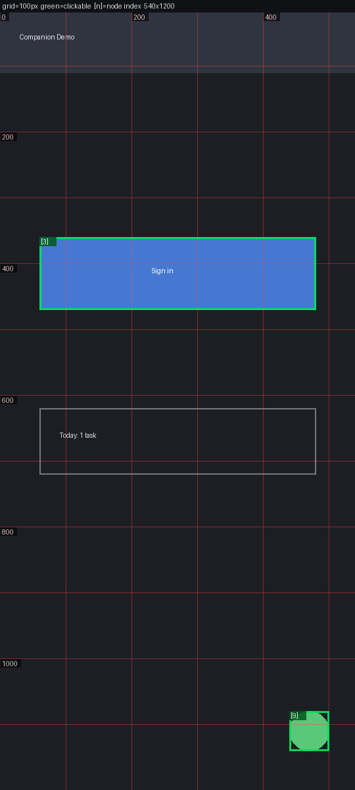

# 手机行动层（L1 设备通道 + L2 行动回合）

**日期**：2026-11-21
**状态**：设备层、行动循环与宿主接线已落地；单元测试覆盖设备层与记录状态，真机验证待手机配对。

## 为什么单独一层

这个插件的"自主"一直停在两处：回复回合有工具但由用户消息触发，主动回合能自己做主但没有工具。
手机操作需要的是第三种东西：**没有消息也能被触发、能多步观察再动作、并把结果留成回执**。
它不该塞进 `proactive.compose`（那里只产出文字），也不该塞进回复工具（那里必须有人先说话）。

## 分层

```
companion_v2/device/
  adb.py         传输：发现 adb、连接/配对、截图、UI 树、tap/type/key/launch、输入法，全部有界
  annotate.py    感知：网格 + 可点节点框 + 序号，生成模型看的截图
  prompt_image.py 把设备截图作为提示图（不是会话证据）
  session.py     循环：观察 → 决策 → 动作 → 再观察；步数/时长/连续失败都有限制
  decider.py     决策：把一次观察变成恰好一个 JSON 动作，只允许契约内的字段
  action_service.py 宿主接线：phone.act 任务、步骤链、记录与触发
tools/phone_probe.py  不启动 AstrBot 的真机探针
```

三层都不依赖 AstrBot：`AdbClient` 可以注入 `runner`，所以测试不需要真机。
决策函数由调用方注入，因此同一个循环既能被回复回合用，也能被后台行动回合用。

## 安全边界（已实现）

- 不提供通用 shell：只有 `tap/swipe/text/key/launch/screencap/uiautomator/wm size/ime/force-stop` 这些具名操作。
- 每次外部命令都有超时；输出有 1 MiB 上限；截图有 8 MiB 上限。
- `input text` 只接受可打印 ASCII，空格转 `%s`；中文走 ADBKeyboard（见下一节），未启用时明确报 `adb_text_unsupported`，不猜。
- `launch` 只接受完整包名，并用 `monkey` 的 LAUNCHER 类别，不做 `am start` 任意 Intent。
- `force_stop` 默认不在 `allowed` 里，必须显式加进去；它只用于"App 自己持有屏幕锁、正常退出无效"的场合。
- 没有 install/uninstall/push/pull/root；这些要等权限层单独设计。
- 多设备必须显式给 serial；不给就拒绝，不猜设备。

## 真机坑位对应的处理

| 坑 | 现在的处理 |
| --- | --- |
| 小米未开「USB 调试（安全设置）」，`input tap` 返回 0 但没反应 | 每步动作后重新观察，画面与节点树都没变就记 `phone_action_ineffective`；连续两次无效直接停下，不重复点 |
| `input text` 打不了中文 | ADBKeyboard 通道（见下） |
| 打完中文立刻切回输入法，字会丢 | 切回延后 30 秒（`ime_restore_seconds`），期间继续用 ADBKeyboard |
| `uiautomator dump` 慢 | 优先 `dump --compressed`，失败再退回完整 dump；每步只 dump 一次（不稳定时最多两次） |
| 节点树停在上一页 | 截图—dump—再截图；两帧不一致就重 dump 一次，仍不一致则标 `stable=false`、不画节点框，并在提示里警告以截图为准 |
| 息屏/AOD 误判，按 POWER 反而灭屏 | `dumpsys power` 同时看 `mWakefulness` 和 `Display Power: state`；需要唤醒时只发 `WAKEUP`，`POWER`/`SLEEP` 已从按键集合移除 |
| App 自己持有屏幕锁 | 可选 `force_stop`（默认关闭，需写进 `allowed`） |
| 网页弹「打开 App」把滑动吃掉 | 提示词要求先 BACK/取消；无变化检测会把"卡住"变成两次失败后停下 |
| QQ 图片后缀不可信 | 属于媒体输入层，不在手机层；需要时按字节头（`GIF89a`/PNG/JPEG）判定，不能看扩展名 |
| start.bat 守护进程堆窗口 | 属于外部桥接脚本，不在插件进程内；需要看脚本本身的清理逻辑 |

## 真机怎么试

1. 手机开发者选项打开「无线调试」，先配对：
   ```powershell
   adb pair 192.168.x.x:37xxx   # 输手机上的六位配对码
   adb connect 192.168.x.x:37xxx
   ```
2. 本机探针：
   ```powershell
   python -X utf8 tools/phone_probe.py status
   python -X utf8 tools/phone_probe.py observe --json
   python -X utf8 tools/phone_probe.py tap-text "签到"
   python -X utf8 tools/phone_probe.py launch com.example.app
   python -X utf8 tools/phone_probe.py screenshot .tmp/phone.png
   ```
3. 跑测试（不需要真机）：
   ```powershell
   python -X utf8 -m pytest tests/test_device_adb.py tests/test_device_decider.py -q
   ```

## 宿主接线

- **模型档**：`phone.act`（`phone_profile`），在 `staging.py` 与 `multi_session.py` 的 profile 元组里注册，`output_defaults` 归入结构化任务。
- **任务**：`TaskDefinition("phone.act")` + `ExactTaskRunner`；一次任务只做**一步**（网关规定每个任务只能开一次模型会话），步骤链存在任务记录里。
- **触发**：`PhoneActionService.advance` 作为 `_drive` 的一个 TickUnit；到点的记录会被提交为一步任务，模型看屏幕做一个动作，写回记录，6 秒后进行下一步。
- **入口**：私聊回复回合里的 `phone.task.start` 工具（仅在手机通道启用时出现）。它只登记目标，不立即执行；模型可以在对话里答应"我晚点自己弄"，真正操作发生在用户不再说话之后。
- **权限**：`phone.act` 动作 + 私聊窗口 + `device.phone` 组启用 + 可选 `allowed_subjects` 白名单；目标窗口不是私聊就直接拒绝。

## 感知：截图 + 坐标网格 + 节点树

每一步的观察同时给模型三样东西：

1. **截图**：原始 `screencap` 上叠加红色坐标网格（每 100px 一条，边缘标数字）、绿框标出可点节点、框内 `[n]` 与该步 UI 树里的节点序号一致；
2. **节点树**：`uiautomator dump` 解析出的可读节点（文本/描述/包名/中心点/是否可点），按序号列出；
3. **文字观察**：屏幕尺寸、网格读数提示、上一步动作与结果。

这样"按文字点"和"按坐标点"指的是同一批目标：有文字的节点优先 `tap_text`，图标或自绘区域按网格读 `x/y`。



注释图保存在 `<V2 数据根>/phone/<task>-<step>.png`，只保留最近 40 张，便于事后核对。

`phone.act` 模型档声明了 `text + image` 能力，因此**需要一个支持图片输入的模型路由**；没有视觉模型时整条手机任务不可用（不会退回纯文字观察），这是刻意的，避免模型在没有画面的情况下猜坐标。

## 中文输入（ADBKeyboard）

`input text` 只支持可打印 ASCII。要可靠输入中文/emoji，需要在手机上装一次
[ADBKeyboard](https://github.com/senzhk/ADBKeyBoard)，然后：

```powershell
adb install ADBKeyboard.apk
adb shell ime enable com.android.adbkeyboard/.AdbIME
adb shell ime set com.android.adbkeyboard/.AdbIME
```

再把 `phone.json` 的 `unicode_input` 设为 `"adbkeyboard"`。运行时会：

1. 记录当前输入法；
2. 切到 ADBKeyboard；
3. `am broadcast -a ADB_INPUT_B64 --es msg <base64>`；
4. 在 `ime_restore_seconds`（默认 30 秒）后再切回原输入法；恢复失败会记下来，在下一次观察时报 `adb_ime_restore_failed`，不会假装成功。

限制：输入框必须已有焦点（先 `tap`）；密码/支付/验证码不要走这条路径；运行时不会替你安装或启用 APK。
用 `python -X utf8 tools/phone_probe.py ime --json` 可以先检查是否安装、当前是哪个输入法。

## 在插件里管理、配置

「陪伴小屋 → 专题配置 → 手机连接 → 手机（ADB）」现在直接编辑 `device.phone` 组（角色级）：

| 字段 | 说明 |
| --- | --- |
| 启用手机通道 | 总闸；关闭后不登记新任务，已排队步骤也不开始 |
| adb 可执行文件路径 | 留空自动发现 |
| 目标设备序列号 | 多设备必填 |
| 无线调试地址 | `host:port`，每次取设备前尝试连接 |
| 单个任务最多步数 | 1–6 |
| 中文输入方式 | `off` / `adbkeyboard` |
| 输入法切回延迟 | 5–120 秒，默认 30 |
| 允许的动作 | 逗号分隔；`done,fail` 必须保留，`force_stop` 默认不含 |
| 允许使用的对象 | 逗号分隔 subject id；空表示不限制 |

`phone.json` 仍保留为**引导回落**：如果这个组一次都没保存过（所有字段都来自默认值），运行时继续读数据根下的 `phone.json`；页面保存任意一个值后，配置组成为唯一来源。

### phone.json（旧引导文件，可继续用）

放在 V2 数据根目录（与 `companion-v2.sqlite3` 同级；本机为
`...\companion-7\installations\main\runtime\`）。只在 `device.phone` 组一次都没保存过时生效：

```json
{
  "enabled": true,
  "adb": "C:/Users/you/AppData/Local/Android/Sdk/platform-tools/adb.exe",
  "serial": "192.168.1.23:37123",
  "connect": "192.168.1.23:37123",
  "max_steps": 4,
  "unicode_input": "adbkeyboard",
  "ime_restore_seconds": 30,
  "allowed": ["launch", "tap_text", "tap", "type", "key", "wait_text", "done", "fail"],
  "allowed_subjects": []
}
```

要给"App 自己持有屏幕锁"的情况开口子，再把 `"force_stop"` 加进 `allowed`；它不在默认集合里。

- `allowed_subjects` 为空表示"所有能私聊这个角色的窗口都可以用"；建议至少填上你自己的 subject id。
- 未知字段、未知动作、非布尔 `enabled` 都会让整份配置被拒绝（通道保持关闭）。
- `connect` 每次取设备前都会尝试一次；无线调试端口变化后改这里即可。

## 一次任务的完整路径

私聊发送「查看手机屏幕」或询问当前 Android 页面，可读取一次当前画面。Bot 通过 `phone.screen.read` / 明确的私聊指令使用 ADB 抓取画面，并用 `phone.act` 配置的视觉模型回答。读屏只返回文字结果，不操作手机，也不保存这次截图。息屏、锁屏或模型不可用时，原私聊会收到具体原因。

1. 用户在私聊里说"明天上午帮我把那个 app 签个到"。
2. 模型调用 `phone.task.start`（`goal`、可选 `delay_minutes`/`max_steps`），返回任务 id；此刻不碰手机。
3. 到点后 TickUnit 提交第一步任务；任务观察屏幕（截图 + UI 树），模型只输出一个 JSON 动作。
4. 动作执行前先把"动作已开始、结果未记录"写进记录；执行后替换成真实结果。进程在两者之间崩溃时，下一步会看到标记并停止，绝不重复点击。
5. 动作成功后 6 秒进行下一步；`done` 收尾为成功，`fail`/连续两次失败/步数用尽收尾为失败。
6. 记录保留最近步骤与结束原因，便于页面和诊断读取。

## 下一步（真机）

- 手机配对后先跑 `tools/phone_probe.py`，确认 `observe` 能列出真实节点；
- 再在私聊里登记一个短目标（如"打开设置并截图"）验证整条链；
- 之后才考虑扩动作（`swipe`、中文输入、安装/卸载）或让日程自己产生手机目标。
